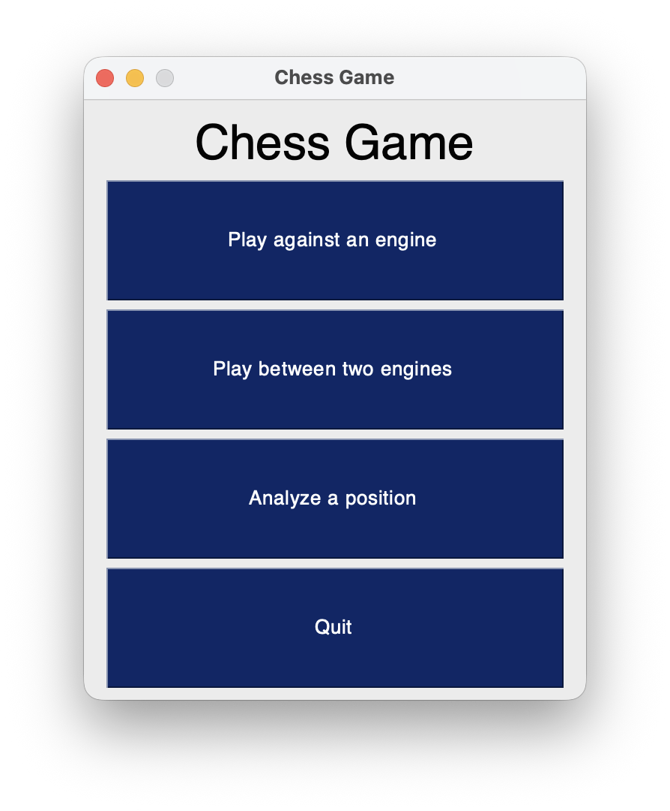

# **Chessli Setup Guide**
This repository contains all the necessary files and instructions to create an installer for the Chessli application. Ofcourse you need to install python so for the best result you should use the installer provided or get it from the official site. Follow the steps below to get started!

## **📥 Step 1: Get the Repository and Engine Files**
**Get the Repository**:

Option 1: Fork the repository to your GitHub account and clone it using Git.

git clone https://github.com/Fatennalover/Chessli.git

Option 2: Download the repository as a ZIP file:
Click the green Code button in the top right.
Select Download ZIP.
Extract the ZIP file into a folder of your choice.
Get the Engine Files:

Get the Windows builds of Stockfish, Leela Chess Zero, and Komodo 14.1 from their publishers. Put the engines and LC0 network under the project’s `engines` directory.
Make sure the folder structure is correct:
The contents should be:

engines/stockfish
engines/lc0-v0.30.0-windows-cpu-openblas
engines/komodo-14
**Important**: Do not rename any files or folders, and avoid nesting them (e.g., no `engines/engines/stockfish`).

## **🛠 Step 2: Install Required Libraries**
Open a terminal or command prompt.
Navigate to the folder where you extracted or cloned the repository. For example:
On Windows: cd path\to\your\Chessli\folder
Replace path\to\your\Chessli\folder with the path to your extracted folder.

Run the following command to install the required Python libraries:

pip install -r requirements.txt

## **🖥 Step 3: Build the Executable**
While still in the repository folder, run this command:

python -m pip install pyinstaller
pyinstaller Chessli.spec

PyInstaller will create a dist folder containing the built files.

## **🧰 Step 4: Modify the Manifest Using Resource Hacker to Make it Run as Admin**
Download and install Resource Hacker from https://www.angusj.com/resourcehacker/.
Open Resource Hacker and navigate to the dist folder created by PyInstaller.
Inside dist, locate the generated Chessli.exe file.
Select the manifest resource:
Expand the manifest section.
Click on the manifest file.
Replace the manifest file's content with the manifest.xml file from the repository.
Open manifest.xml in a text editor (e.g., Notepad).
Copy all the text.
Paste it into the manifest editor in Resource Hacker.
Save the changes and overwrite the original .exe file.

## **📦 Step 5: Create the Installer Using Inno Setup**
Download and install Inno Setup from https://jrsoftware.org/isinfo.php.
Open the Chessli.iss file from the repository in Inno Setup.
Press the Compile or run button (a blue play button) at the top in the toolbar.
Inno Setup will create an installer for Chessli in the output directory you specify.

## **🎉 You're Done!**
You now have a fully functional installer for Chessli. If you have any problems you can leave a Issue report on GitHub. You can share the installer or use it to easily set up Chessli on other systems.

